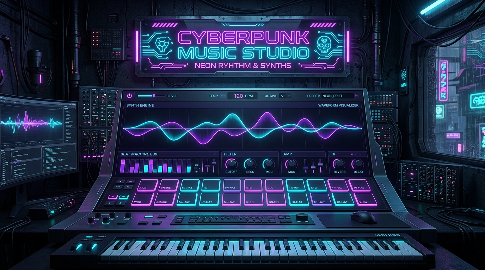

# Synth Online 🎛️⚡

[](https://github.com/leonardoconstantino/synth-online/actions/workflows/deploy.yml)
[](https://react.dev/)
[](https://www.typescriptlang.org/)
[](https://tonejs.github.io/)
[](https://tailwindcss.com/)
[](https://opensource.org/licenses/MIT)

> **Sintetizador polifônico virtual e drum machine contemporâneo desenvolvido com Web Audio API, Tone.js, React e TypeScript.** Projetado com modos intuitivo (Leigo/Simples) e aprofundado (Expert), rack de efeitos estéreo, visualizador de forma de onda em tempo real e persistência local de presets via IndexedDB.

---

### 🌐 Acesso Online & Demonstração

Acesse a versão final publicada e pronta para tocar no seu navegador:

👉 **[https://leonardoconstantino.github.io/synth-online/](https://leonardoconstantino.github.io/synth-online/)**

---

### 📸 Prévia da Aplicação

<div align="center">
  
</div>

---

## ✨ Principais Recursos

- **🎹 Síntese Polifônica Completa**:
  - Vozes simultâneas com gerenciamento dinâmico de alocação de vozes (`VoiceManager`).
  - Suporte a múltiplos tipos de onda: *Sine*, *Triangle*, *Square*, *Sawtooth*, *Fat Sawtooth* (estéreo com detune) e *FM Synthesis*.
  - Envelope de amplitude ADSR de alta precisão (Attack, Decay, Sustain, Release).
- **🥁 Drum Machine & Percussão (16 Pads 4×4)**:
  - **Kits Acústicos**: Bumbo 22", Caixa de Madeira com esteira, Rimshot, Surdo de chão, Tons Médio/Alto, Chimbal Fechado/Aberto/Pedal, Pratos Crash e Ride/Bell.
  - **Kits Eletrônicos Lendários**: Bumbo Sub 808, Caixa 808/909, Palmas (*Clap*), Cowbell afinado.
  - **Percussão Latina & Geral**: Congas graves e agudas, Shaker granulado.
  - Alternância imediata entre modo melódico cromático e pads de bateria dedicados.
- **🎚️ Modos de Interface Duplos**:
  - **Modo Simples (Leigo)**: Focado em usabilidade imediata, seleção de timbres em destaque e controles macro de volume, filtro e dinâmica.
  - **Modo Expert**: Painéis detalhados de osciladores, curva ADSR interativa, filtro ressonante passa-baixas/passa-altas/passa-faixa com envelope dedicado e LFO com alvos dinâmicos.
- **🌌 Rack de Efeitos Estéreo Integrado**:
  - **Reverb Convolucional/Espacial**: Profundidade e sustentação de ambiência com pre-delay ajustável.
  - **Stereo Delay**: Tempo de atraso sincronizável e feedback estéreo.
  - **Chorus Analógico**: Modulação rica para dar amplitude e textura aos timbres.
  - **Master Limiter**: Proteção contra clipping digital e saturação auditiva.
- **📊 Visualizador em Tempo Real**:
  - Osciloscópio estéreo exibindo a forma de onda resultante em 60 FPS através da Web Audio API.
- **💾 Gerenciador de Presets com IndexedDB**:
  - Presets de fábrica prontos para uso (*Dream Machine*, *Studio Acoustic Kit*, *TR-808 Classic*, *Acid Bass*, *Ethereal Lead*, etc.).
  - Criação, edição, exportação e salvamento de presets personalizados salvos localmente no navegador.

---

## ⌨️ Guia de Controles e Atalhos

A aplicação foi desenhada para resposta instantânea tanto por toque/mouse quanto pelo teclado físico do seu computador:

### 🎹 Teclado do Computador (Piano Virtual)
| Teclas | Notas Musicais |
| :--- | :--- |
| **`A`, `W`, `S`, `E`, `D`, `F`, `T`, `G`, `Y`, `H`, `U`, `J`, `K`** | Escala cromática (Dó, Dó#, Ré, Ré#, Mi, Fá, Fá#, Sol, Sol#, Lá, Lá#, Si, Dó) |
| **`Z` / `X`** | Diminuir / Aumentar Oitava base (C1 a C7) |

### 🥁 Grid de 16 Pads (Bateria & Disparos)
A matriz 4×4 de pads mapeia perfeitamente as 4 linhas superiores do seu teclado:

```
[  1  ]  [  2  ]  [  3  ]  [  4  ]    -> Linha 1 (Bumbos / Caixa / Rimshot / Clap)
[  Q  ]  [  W  ]  [  E  ]  [  R  ]    -> Linha 2 (Chimbais Fechado/Pedal/Aberto / Crash)
[  A  ]  [  S  ]  [  D  ]  [  F  ]    -> Linha 3 (Surdo / Tom Médio / Tom Alto / Ride)
[  Z  ]  [  X  ]  [  C  ]  [  V  ]    -> Linha 4 (Cúpula Ride / Cowbell / Congas / Shaker)
```

> **Dica**: No modo notas, você pode clicar no ícone de engrenagem em qualquer pad para customizar a nota musical e a tecla de atalho associada!

---

## 🛠️ Tecnologias Utilizadas

- **Framework**: [React 19](https://react.dev/) + [TypeScript](https://www.typescriptlang.org/)
- **Bundler & Dev Server**: [Vite 8](https://vitejs.dev/)
- **Engine de Áudio**: [Tone.js 15](https://tonejs.github.io/) (Web Audio API)
- **Estilização**: [Tailwind CSS v4](https://tailwindcss.com/)
- **Gerenciamento de Estado**: [Zustand](https://github.com/pmndrs/zustand)
- **Persistência**: [idb (IndexedDB)](https://github.com/jakearchibald/idb)
- **Componentes & Ícones**: [Radix UI](https://www.radix-ui.com/) & [Lucide Icons](https://lucide.dev/)

---

## 🚀 Como Executar Localmente

### Pré-requisitos
- [Node.js](https://nodejs.org/) versão 18 ou superior (recomendado 20+).
- Gerenciador de pacotes `npm`, `yarn` ou `pnpm`.

### Passo a Passo

1. **Clonar o repositório:**
   ```bash
   git clone https://github.com/leonardoconstantino/synth-online.git
   cd synth-online
   ```

2. **Instalar as dependências:**
   ```bash
   npm install
   ```

3. **Iniciar o servidor de desenvolvimento:**
   ```bash
   npm run dev
   ```
   Abra no seu navegador o endereço indicado (por padrão `http://localhost:3000`).

4. **Verificar tipos e linting:**
   ```bash
   npm run lint
   ```

5. **Gerar a build de produção:**
   ```bash
   npm run build
   ```
   Os arquivos compilados e otimizados serão gerados na pasta `./dist`.

6. **Testar a prévia da build localmente:**
   ```bash
   npm run preview
   ```

---

## 🔄 Deploy Automático no GitHub Pages

Este repositório possui uma pipeline de Integração Contínua (CI/CD) configurada via **GitHub Actions** em [`.github/workflows/deploy.yml`](.github/workflows/deploy.yml).

### Como funciona:
1. A cada `git push` realizado nas branches `main` ou `master` (ou ao disparar manualmente via `workflow_dispatch`), o GitHub Actions:
   - Clona o código-fonte atualizado.
   - Configura o ambiente Node.js 20.
   - Instala as dependências de forma limpa.
   - Executa a verificação estática de tipos (`npm run lint`).
   - Compila a aplicação via Vite com a variável `GITHUB_ACTIONS=true` (garantindo que o caminho base dos assets seja configurado para `/synth-online/`).
   - Gera o arquivo `404.html` como fallback de roteamento SPA.
   - Faz o upload do pacote para o GitHub Pages e efetua a publicação no ambiente de produção.

---

## 📄 Licença

Este projeto é distribuído sob os termos da licença **MIT**. Veja o arquivo [LICENSE](LICENSE) para mais detalhes.

---

<div align="center">
  Desenvolvido com 💜 por <a href="https://github.com/leonardoconstantino">Leonardo Constantino</a>.
</div>
